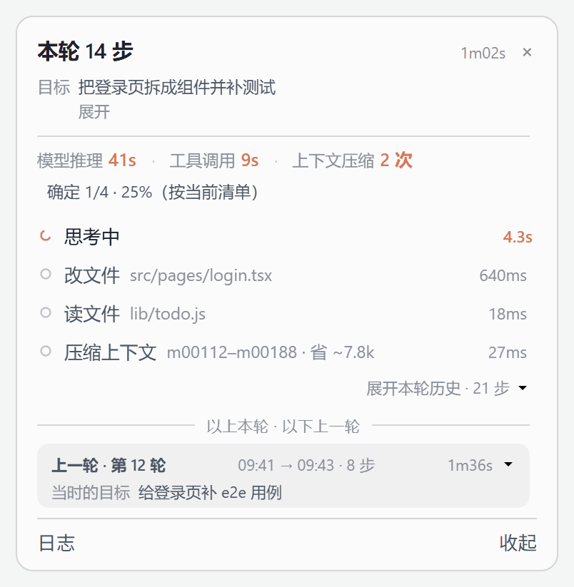
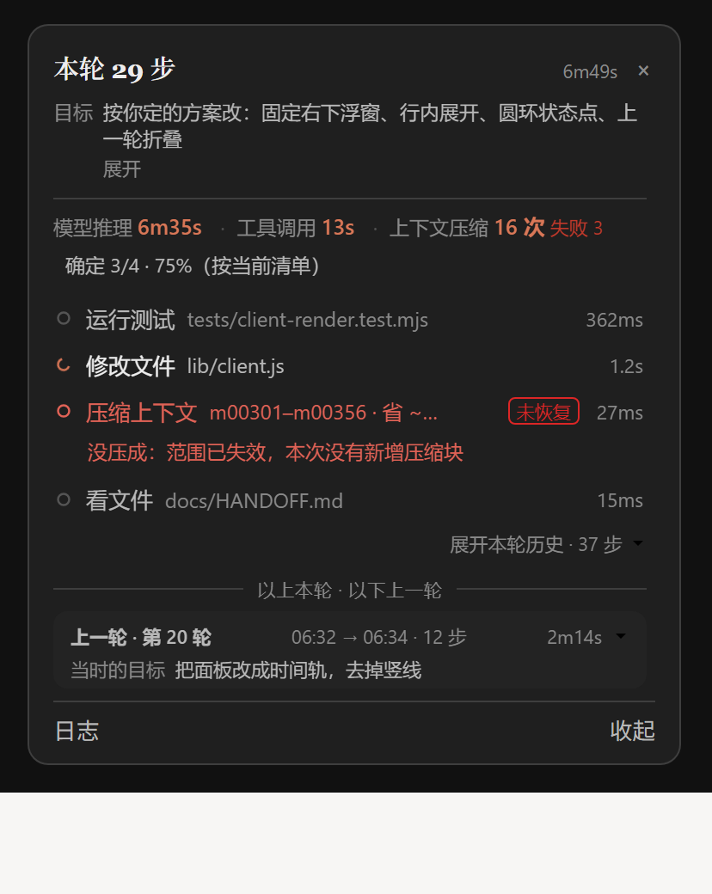

# dsh-work-status

**简体中文** · [English](./README.en.md)

> 一行状态看清 Agent 在做什么；点开是目标、当前步、最近的记录与上一轮。

[](https://github.com/xsllo425/dsh-work-status/actions/workflows/ci.yml)
[](./LICENSE)
[](https://github.com/topics/dsh-plugin)

一个 [DeepSeek Harness](https://github.com/deepseek-ai/deepseek-harness) 插件，用尽量少的注意力回答一个问题：

> **它现在在做什么、已经做完了什么、有没有卡住？**

默认只在输入框上方占一行，点开是工作状态，再点收起。

```
● 本轮 29 步                                            6m49s  ⌃
```

点开之后：

```
本轮 29 步                                              6m49s  ×
目标  按你定的方案改：固定右下浮窗、行内展开、圆环状态点…
模型推理 6m35s · 工具调用 13s · 上下文压缩 16 次 失败 3
确定 3/4 · 75%（按当前清单）
○ 跑测试    tests/client-render.test.mjs                    362ms
● 改文件    lib/client.js                                    1.2s
✗ 压缩上下文 m00301–m00356 · 省 ~…                  未恢复  27ms
  没压成：范围已失效，本次没有新增压缩块
展开本轮历史 · 37 步 ⌄
上一轮 · 第 20 轮                                          2m14s ⌄
                                   日志 · 复制 · 收起
```





> 动图（浅色）：进行中、失败、失败被后来的同类成功救回（划掉转灰）、进度随清单推进——状态会变，静态图看不出来。
> 都用插件自己的样式表和文案、套主题令牌渲染；运行中的应用是同一套结构，只是填真实数据。

## 显示什么

- **默认一行**：干活时显示当前动作与已用时，结束后显示本轮完成步数；不往对话区上浮任何卡片。
- **目标与当前问题**：你提的要求、它正在处理的小问题，各自截断并可展开。
- **三个分开的时钟**：模型推理、工具调用、上下文压缩各自计时，不合并成一个“已用时”；单步耗时按类别（本地 / 网络 / 后台）拆开，不是一笔糊账。
- **只在有真实数据时给进度**：agent 维护 todo 清单时才显示百分比（`确定 3/4 · 75%`，并注明“按当前清单”）；没有清单就只说“未知 · 已耗时”，不对整轮外推 ETA。
- **每个动作都说人话**：`跑测试`、`改文件`、`压缩上下文`，带目标与耗时。失败标 `未恢复` 或 `已恢复`（同一目标后来成功），能识别时直接给一句人话，不甩栈。
- **上下文维护按普通记录排**：压缩 / 恢复 / 检索与工具行按时间排在一起，能看出它插在哪一步，又不虚增步数。
- **上一轮**：上一轮折叠成一行放在分割线下，轮次结束后卡片仍能回答“刚做了什么”。
- **会话日志**：轮次、步数、调用次数、每轮推理/工具用时、压缩次数与失败、最近 24 轮，可一键复制成纯文本。

## 刻意不做的事

- 不调模型、不注提示词、不发网络请求，数据不出本机。
- 不还原“思考内容”，只报告可观察事件；事实与推断分开，不知道就写不知道。
- 没有 todo 数据就不画进度条，不做 0% / 100% 的装饰。
- 不评价 agent 想得对不对。

## 安装

插件是一个 DeepSeek Harness bundle，用插件管家安装：

| 来源 | 命令 |
| --- | --- |
| 本地目录 | `install link:E:/path/to/dsh-work-status` |
| 打包文件 | `npm pack` → `install file:./dsh-work-status-<version>.tgz` |
| GitHub | `dsh plugin --profile web add github:xsllo425/dsh-work-status`<br>（插件内命令可简写为 `install github:xsllo425/dsh-work-status`） |

桌面端也可以走 插件 → 添加插件，直接填仓库地址。

- 改动宿主侧（`lib/activity.js`、`stateVersion`）需要重启 Harness；只改客户端会随页面刷新加载。
- 卸载即移除这一行；插件不写自己的会话数据。
- 没有需要配置的项。

## 本地步耗时统计

新会话的前几步想显示「同类通常 3–8 秒」，就得知道以前同类步用了多久，插件为此在本机记一份小统计。

- 位置：`~/.dsh/work-status/step-stats.json`（Windows：`%USERPROFILE%/.dsh/work-status/step-stats.json`）。
- 内容：工具归类键（`model|read`、`tool|local|edit` 等）+ 整数毫秒。不含路径、命令、提示词、会话 id、时间戳。
- 有上限：每类最多 30 个样本、最多 48 类，文件长期只有几 KB。
- **随时可以直接删掉这个文件**，等于回到冷启动；下一轮结束后会自动重建，插件不会因此报错。
- 想彻底关闭，设 `DSH_WORK_STATUS_NO_HISTORY=1`。
- 来自历史会话的参照在面板上标「据历史」；本会话同类样本攒够 5 个后会自动改用本会话数据。

## 兼容性

- DeepSeek Harness `>= 0.2.1-rc.2`，Web UI。
- 可选：装了 [`dsh-claude-style`](https://github.com/Nwflower/dsh-claude-style) 并把桌宠放在输入框上方时，插件隐藏自己的徽标，改为**右键桌宠**打开面板。
- 不含对方的美术资产：只读它的 CSS 类名（`.dsh-claude-deepy` / `.dsh-claude-crab`），不复制、不内联任何桌宠图片；螃蟹「Clawd」是 Anthropic 的角色，版权不在本项目。
- 不绑定主题：颜色、描边、字体都取宿主 CSS 变量（`--dsw-alias-*`），浅色/深色/第三方主题自动跟随。

## 开发

```bash
node --check lib/client.js && node --check lib/activity.js && node --check lib/index.js
node --test tests/*.test.mjs          # 86 项，无任何依赖
node scripts/check-manifest.mjs       # 清单、导出、补丁行、图标、语言包
```

无运行时依赖，也无开发依赖，Node 24 直接跑。

```
lib/index.js        宿主入口，注册会话投影
lib/activity.js     纯事件折叠（stateVersion 18，投影键 "workStatus"）
lib/client.js       Web UI：徽标、面板、时间轨、日志、双语文案、样式
locale/*.json       插件列表里的名称与简介（中/英）
icon.svg            插件图标
cordis.patch.yml    bundle 补丁行
docs/               HANDOFF.md、RESEARCH-COMMUNITY.md、STATS.md
```

客户端不折叠事件，只渲染投影。投影状态形状变化时必须递增 `stateVersion`——旧 checkpoint 会被丢弃，从日志重放。

## 文档

- [docs/HANDOFF.md](docs/HANDOFF.md) — 交接：投影契约、代码地图、测试策略、宿主怪癖
- [docs/RESEARCH-COMMUNITY.md](docs/RESEARCH-COMMUNITY.md) — 九个社区进度插件的对与错
- [docs/STATS.md](docs/STATS.md) — 耗时显示背后的实测统计
- [docs/RELEASE.md](docs/RELEASE.md) — 发布前检查清单
- [docs/FINAL-CHECK.md](docs/FINAL-CHECK.md) — 交付前总检（范围级）
- [CHANGELOG.md](CHANGELOG.md) — 逐版本记录

想立刻清掉它：`npm run reset-stats`（先看路径可加 `-- --dry`）。

介绍用的 7 页 PPT：[docs/dsh-work-status-intro.pptx](docs/dsh-work-status-intro.pptx)（封面、界面、口径、边界、安装）。

## 边界

- 显示的一切都来自会话事件流；工具结果没回来时，那一行写「结果未知」，不猜。
- 数字都是**本会话**单轮或单步的；跨会话历史只存在本机，有上限，可随时删除（见下面「本地数据」）。
- 桌宠联动是 best-effort：它盯的是 dsh-claude-style 的吉祥物，属于主题内部实现。主题一改就可能失效；给 `<html data-dws-pet="off">` 就能停掉联动，徽标会自动回来。
- 只有计划有真实总数（n/m 待办）时才画百分比；没有就只报已用时间和「未知」，绝不编进度条。

## 许可

MIT。部分代码派生自 [dsh-agent-activity](https://github.com/oxygenforce/dsh-agent-activity) 0.9.0（MIT），见 [NOTICE](NOTICE)。
