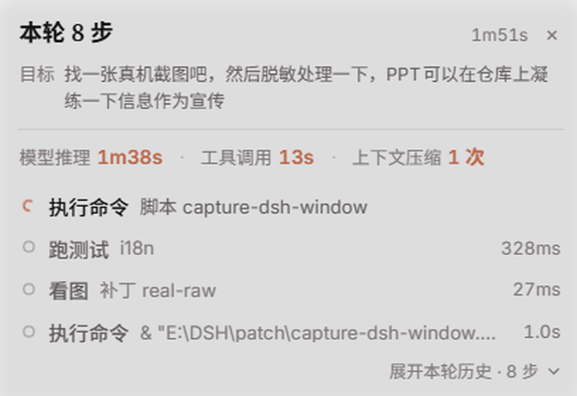

# dsh-work-status

> One line tells you what the agent is doing; click once for the goal, the current step, the last few records and the previous turn.

[](https://github.com/oxygenforce/dsh-work-status/actions/workflows/ci.yml)
[](./LICENSE)
[](https://github.com/topics/dsh-plugin)

A [DeepSeek Harness](https://github.com/deepseek-ai/deepseek-harness) plugin that answers one question with the least possible attention:

> **What is the agent doing right now, what has it actually finished, and is anything stuck?**

It renders a single compact row above the composer. Click it for the working state; click again to fold.

```
● 本轮 29 步                                            6m49s  ⌃
```

Open it:

```
本轮 29 步                                              6m49s  ×
目标  按你定的方案改：固定右下浮窗、行内展开、圆环状态点…
模型推理 6m35s · 工具调用 13s · 上下文压缩 16 次 失败 3
确定 3/4 · 75%（按当前清单）
○ 跑测试    tests/client-render.test.mjs                    362ms
● 改文件    lib/client.js                                    1.2s
✗ 压缩上下文 m00301–m00356 · 省 ~…                  未恢复  27ms
  没压成：范围已失效，本次没有新增压缩块
展开本轮历史 · 37 步 ⌄
上一轮 · 第 20 轮                                          2m14s ⌄
                                   日志 · 复制 · 收起
```



*Real screenshot; sidebar, session title and messages are blurred.*


> Rendered from the plugin's own stylesheet and copy against the theme tokens; the running app draws the same markup with live data.

## What it shows

- **One line by default** — current step plus elapsed time while working; completed step count when idle. Nothing floats over the conversation.
- **Goal and current problem** — the user's request and the sub-problem the agent is on, each clamped and expandable.
- **Three separate clocks** — model reasoning, tool calls, context compression. They are never merged into one "elapsed" number, and per-step cost is broken down by category (local / network / background) instead of one opaque duration.
- **Progress only when it is real** — a percentage exists only when the agent keeps a todo list (`确定 3/4 · 75%`, labelled *per current list*). Otherwise the card says *unknown · elapsed*; it never extrapolates a whole-turn ETA.
- **Every action in plain words** — `跑测试`, `改文件`, `压缩上下文`, with target and duration. A failure is tagged *未恢复* or *已恢复* (a later success on the same target) and, when the error is recognisable, explained in one sentence instead of a stack trace.
- **Context maintenance as normal rows** — compress / decompress / search appear inline with tool rows, so you see where they happened; they do not inflate step counts.
- **Previous turn** — the last turn folds into one row under a divider, so the card still answers "what did it just do?" after a turn ends.
- **Session log** — turns, steps, tool calls, per-turn reasoning/tool time, compression count and failures, last 24 turns, copyable as text.

## What it deliberately does not do

- No model calls, no prompt injection, no network requests: nothing leaves the machine.
- No "thinking" reconstruction — only observable events. Facts are separated from inference, and unknown stays unknown.
- No 0% / 100% decoration: without todo data there is no bar.
- No grading of the agent's reasoning.

## Install

The package is a DeepSeek Harness bundle. Install it with the Plugin Manager:

| Source | Command |
| --- | --- |
| Local directory | `install link:E:/path/to/dsh-work-status` |
| Packed tarball | `npm pack` → `install file:./dsh-work-status-<version>.tgz` |
| GitHub | `install github:oxygenforce/dsh-work-status` |

In the desktop app, Plugin Manager → 添加插件 also accepts the repository URL directly.

- Host changes need a Harness restart; client-only changes reload with the page.
- Uninstall removes the row; the plugin writes no session data of its own.
- There is nothing to configure.

## Local step statistics

To show "usually 3–8s" on the very first turns of a new session, the plugin remembers how long each kind of step took in earlier sessions.

- Location: `~/.dsh/work-status/step-stats.json` (Windows: `%USERPROFILE%/.dsh/work-status/step-stats.json`).
- Contents: tool-class keys (`model|read`, `tool|local|edit`, …) and integer milliseconds. No paths, commands, prompts, session ids or timestamps.
- Bounded: at most 30 samples per key and 48 keys; the file stays a few KB.
- **Delete the file** at any time to go back to a cold start; the plugin recreates it on the next finished turn and never fails because of it.
- Disable entirely with `DSH_WORK_STATUS_NO_HISTORY=1`.
- Values from previous sessions are labelled `(from history)` in the panel; once the current session has 5 samples of the same kind, they take over silently.

## Compatibility

- DeepSeek Harness `>= 0.2.1-rc.2`, Web UI.
- Optional: when [`dsh-claude-style`](https://github.com/Nwflower/dsh-claude-style) renders a mascot above the composer, the plugin hides its own badge and opens on **right-click** of the mascot instead.
- Theme-agnostic: colors, borders and fonts come from host CSS variables (`--dsw-alias-*`), so light/dark and custom themes work without plugin-specific styling.

## Development

```bash
node --check lib/client.js && node --check lib/activity.js && node --check lib/index.js
node --test tests/*.test.mjs          # 69 tests, no dependencies
node scripts/check-manifest.mjs       # manifest, exports, patch row, icon, locales
```

There are no runtime or dev dependencies; tests run on plain Node 24.

```
lib/index.js        host entry — registers the session projection
lib/activity.js     pure event fold (stateVersion 16, key "workStatus")
lib/client.js       web UI: chip, panel, timeline, log, dictionaries, CSS
locale/*.json       plugin-list metadata (zh/en)
icon.svg            plugin icon
cordis.patch.yml    bundle patch row
docs/               HANDOFF.md, RESEARCH-COMMUNITY.md, STATS.md
```

The client never folds events; it renders the projection. When the projection's state shape changes, bump `stateVersion` — stale checkpoints are discarded and rebuilt from the log.

## Docs

- [docs/HANDOFF.md](docs/HANDOFF.md) — developer handover: contracts, code map, test strategy, host quirks
- [docs/RESEARCH-COMMUNITY.md](docs/RESEARCH-COMMUNITY.md) — what nine community progress plugins got right and wrong
- [docs/STATS.md](docs/STATS.md) — measured statistics behind the timing display
- [docs/RELEASE.md](docs/RELEASE.md) — release pre-flight checklist
- [CHANGELOG.md](CHANGELOG.md) — per-version notes

To wipe it: `npm run reset-stats` (add `-- --dry` to see the path first).

A 7-slide intro deck: [docs/dsh-work-status-intro.pptx](docs/dsh-work-status-intro.pptx).

## Limits

- Everything shown comes from the session event stream; when a tool result never arrives the row says “结果未知” instead of guessing.
- Numbers are per turn or per step of the **current session**. Cross-session history is local only, capped, and can be deleted (see “Local data” below).
- The mascot hook is best-effort: it targets the dsh-claude-style mascot (a theme internal). If the theme changes, set \`<html data-dws-pet="off">\` to drop the hook — the status chip comes back automatically.
- Percentages are only drawn when the plan has a real total (n/m todos). Otherwise you get elapsed time and “unknown”, never an invented bar.

## License

MIT. Derived in part from [dsh-agent-activity](https://github.com/oxygenforce/dsh-agent-activity) 0.9.0 (MIT); see [NOTICE](NOTICE).
